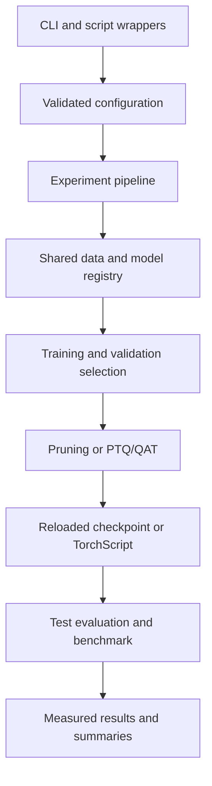

# Architecture

`data.py` owns all preprocessing, splits and calibration loaders. `models.py`
owns the ten-class backbone registry. `training.py` selects the best weights on
validation data. `pruning.py` and `quantization.py` transform independent copies
of the source checkpoint. `pipeline.py` creates runs and evaluates reloaded
artifacts. `benchmark.py` owns timing conventions, and `reporting.py` aggregates
only compatible completed runs.

## Checkpoint design

Float checkpoints contain tensors, primitive metadata and a recipe for every
Conv2d, BatchNorm2d and Linear layer. Loading builds the known backbone on the
meta device, applies the layer recipe and assigns the saved tensors. This
reconstructs the channel topology after structured pruning without loading a
pickled model object. Unstructured checkpoints retain original weights and masks;
the masks stay active during further fine-tuning. Benchmarking/export makes a
separate float inference copy with effective masked weights.

Baseline `last.pt` includes optimizer, Python/NumPy/PyTorch random states,
DataLoader generator state, history, current epoch and the best state. `best.pt`
stores the weights actually selected on validation data. Resume reuses the data
protocol and rejects changes to the optimizer, learning rate, batch size, worker
count and other reproducibility controls. Resume currently supports baseline
training only. Optimizers use a constant configured learning rate; there is no
implicit scheduler or AMP policy.

Quantized models use a converted PyTorch FX graph and CPU TorchScript serialization.
The sidecar JSON records backend, protocol and actual quantized-operator count.
Test metrics are computed from the reloaded TorchScript file. CPU static INT8
does not mean every operation is integer: unsupported activations can remain
float between quantized operators. Packed quantized parameter/MAC counts are
left unavailable rather than reported as misleading zeros.

The quantization adapter deliberately targets PyTorch 2.8 / torchvision 0.23.
FX quantization and the selected TorchScript ONNX exporter are legacy APIs in
newer PyTorch releases. Upgrading requires a tested adapter migration, not just
removing the version constraints. The rest of the package is separated from
that adapter.

## Run integrity

Each invocation creates a unique UTC-stamped folder. Configuration, environment
and split metadata accompany every measured run. JSON and float checkpoints
are written through temporary files. A failed run stays marked `failed` with
its error so interrupted experiments can be diagnosed. The reporting command
rejects failed runs, duplicate measurements and incompatible protocols. CSV
append checks the existing schema and always writes the new row.

## Boundaries

This release is a single-process experiment runner. Simultaneous threads changing
global PyTorch RNG, quantization backend or deterministic settings are unsupported.
Sweeps run sequentially. Every compression method starts from that seed's baseline;
methods are not chained. The package does not implement distillation, streaming
data, distributed training, hardware power measurement or FPGA compilation.
