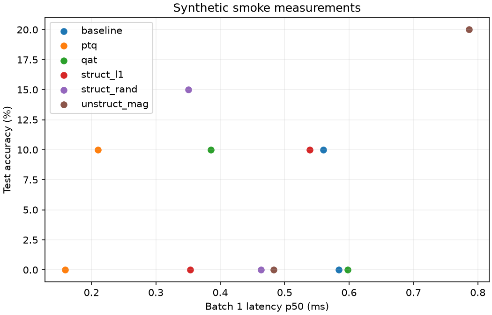

# Checked example outputs

`smoke/` contains the results of a real offline run through training, structured
L1/random pruning, persistent unstructured masking, PTQ, QAT, artifact reload and
benchmarking. It uses TinyCNN, FakeData and seeds 42/43. These numbers validate the
software workflow only; synthetic accuracy is not CIFAR-10 performance.

- [Raw measurements](smoke/measurements.csv): one method/seed/batch record per run.
- [Grouped summary](smoke/summary.csv): means, sample deviations and seed counts.
- [Results JSON](smoke/results.json): test metrics, profiling and source checksums.
- [Provenance](smoke/provenance.json): exact configuration and environment.

Rebuild with `python scripts/generate_smoke_example.py`. The script creates models
in a temporary directory and commits no checkpoints or downloaded training data.
Timing values depend on the machine and are expected to change.

`backbone_checks.json` records additional functional probes on ResNet-18,
MobileNetV3 Large, EfficientNet-B0 and VGG16-BN: dependency-aware structured pruning,
exact checkpoint reload, and finite ten-class PTQ/QAT outputs. These use randomly
initialized networks and one synthetic training/calibration batch. Rebuild with
`python scripts/verify_backbones.py`; VGG's large classifier requires additional RAM.
